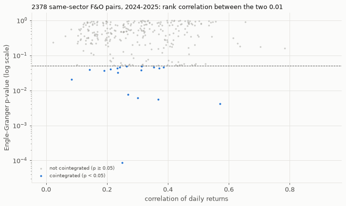
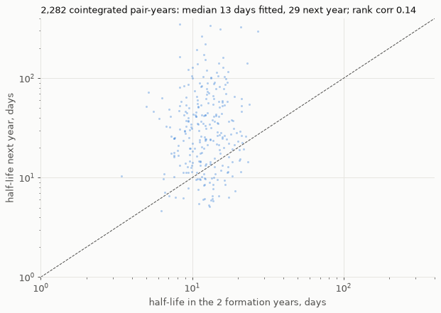
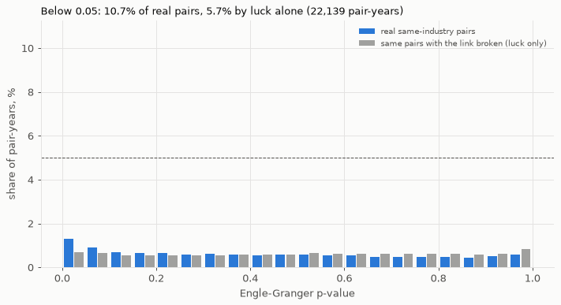
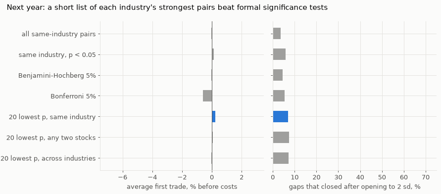
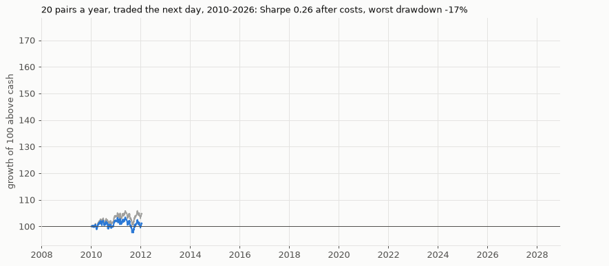
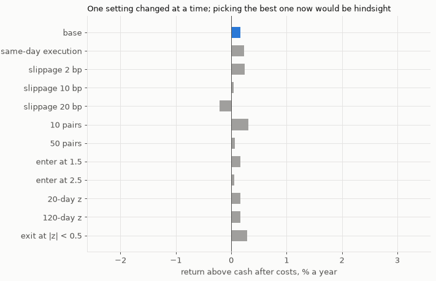
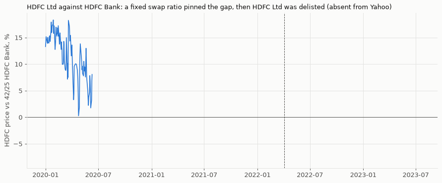
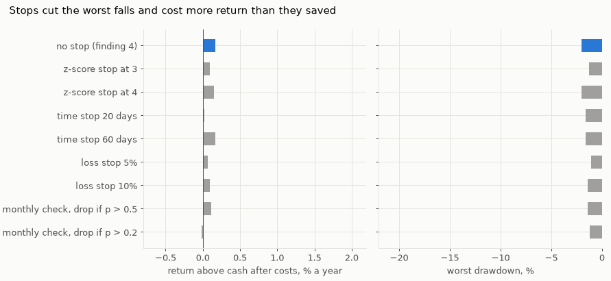

# Pairs Trading

[](https://github.com/Dhirajdas18/pairs-trading/actions/workflows/ci.yml)
[](https://dhirajdas18.github.io/pairs-trading/)

Pairs trading on NSE F&O stocks (about 217, daily data from 2007): which pairs hold together, how to
measure their gap, and what is left after futures costs. Every leg is an F&O stock, because in India a
short held overnight needs a stock future. Every result is scored out of sample.

**Live pair explorer: [dhirajdas18.github.io/pairs-trading](https://dhirajdas18.github.io/pairs-trading/)**,
pick two stocks and see the hedge ratio, cointegration test, half-life, spread, z-score and a backtest,
computed in your browser; rebuilt every week from fresh data by GitHub Actions.

## Features

- [x] Correlation against cointegration: which one picks pairs whose gap closes the next year
- [x] Spread, hedge ratio, z-score and half-life: fixed against rolling z-scores, half-life carry-over
- [x] Finding pairs across the F&O list: luck rate by placebo, multiple-testing corrections, ranking and filters
- [x] A z-score rule out of sample after stock-futures costs, monthly rolls and whole lots
- [x] When pairs break: a merger, stop rules, a monthly health check, and early-warning signs
- [ ] Kalman hedge ratio against a fixed one, out of sample
- [ ] A portfolio of pairs against NIFTY after costs

## Findings

### 1. Correlation doesn't find cointegrated pairs; cointegration finds gaps that close

<a href="docs/img/corr_vs_coint.png"><picture><source media="(prefers-reduced-motion: reduce)" srcset="docs/img/corr_vs_coint.png"></picture></a>

<table><tr>
<td><a href="docs/img/corr_vs_pvalue.png"><picture><source media="(prefers-reduced-motion: reduce)" srcset="docs/img/corr_vs_pvalue.png"></picture></a></td>
<td><a href="docs/img/coint_next_year.png"><picture><source media="(prefers-reduced-motion: reduce)" srcset="docs/img/coint_next_year.png"></picture></a></td>
</tr></table>

Correlation asks whether two stocks move the same way on the same day; cointegration asks whether the
gap between their log prices keeps returning to a fixed level, which is what a pair trade bets on. The
Engle-Granger test fits the hedge ratio by least squares and runs an ADF test on the leftover spread
(matches `statsmodels` `coint` to 1e-6). Every same-industry pair of today's F&O stocks is fitted on two
calendar years and followed through the next with everything frozen: 22,139 pair-years, 2010–2026.

- **The two measures are unrelated.** Across 2,378 pairs fitted on 2024–25, the rank correlation between
  return correlation and the cointegration p-value was 0.01. The made-up pairs above show why: 0.84
  correlation with a gap that wanders off (p 0.53), 0.38 with a gap pulled back every week (p < 0.001).
- **Cointegration picks gaps that close.** Once next year's spread moved 2 formation standard deviations,
  it came back to its mean within the year for 48% of cointegrated pairs (p < 0.05), 35% of the 10% most
  correlated and 30% of all pairs. The rate falls steadily with the p-value (51% below 0.01, 21% above
  0.5) and held in 2010–15, 2016–20 and 2021–26.
- **Half still don't close.** Cointegrated pairs looked tight on their fitting years (median spread
  standard deviation 0.079 against 0.125), so next year 95% moved 2 of those deviations and 62% ended the
  year more than 2 away.
- **Many passes are luck:** 10.7% of pair-years had p < 0.05, against 5% if no pair were cointegrated.

### 2. The fitted band is too narrow; a rolling z-score works better, and half-life doubles

<a href="docs/img/spread_example.png"><picture><source media="(prefers-reduced-motion: reduce)" srcset="docs/img/spread_example.png"></picture></a>

<table><tr>
<td><a href="docs/img/spread_choices.png"><picture><source media="(prefers-reduced-motion: reduce)" srcset="docs/img/spread_choices.png"></picture></a></td>
<td><a href="docs/img/half_life.png"><picture><source media="(prefers-reduced-motion: reduce)" srcset="docs/img/half_life.png"></picture></a></td>
</tr></table>

The z-score is how many standard deviations the spread is from its mean. Same pairs and years as
finding 1; each choice is frozen at the end of the fitting years. The trade test enters when |z| > 2,
betting on the gap closing, and exits when z crosses 0 or at year end: first trade per pair-year,
before costs.

- **The fitted band is too narrow.** Next year, cointegrated spreads sat a typical 2.3 formation standard
  deviations from their formation mean, so a fixed z-score was beyond ±2 on 45% of days, where a stable
  spread gives about 5%. HDFC Bank against ICICI Bank (top) passed on 2024–25 (p 0.001, half-life 13
  days), then slid about 30% in 2026; with no stop, its first trade lost about 17% (fixed z) and 13%
  (rolling 60-day z).
- **A rolling z-score turns losses into small gains.** On cointegrated pairs the fixed band averaged
  −0.95% a first trade; rolling 20, 60 and 120-day z-scores averaged +0.57%, +1.09% and +0.66%, winning
  69–71%. On pairs with no cointegration (p > 0.5) every choice lost. The 60-day result was positive in
  14 of 17 years but lost 7% in 2018 and 2020.
- **A rolling z-score always looks like it works:** its mean follows the spread, so it returned to zero
  after nearly every entry, cointegrated or not. Judge it by what the spread did.
- **The hedge-ratio method barely matters.** Least squares of A on B and total least squares both closed
  48% of opened gaps; B on A 45%; a plain price ratio (equal rupees each side) 28%.
- **Half-life doubles.** Cointegrated pairs: median 13 days on the fitting years, 29 the next year; the
  rank correlation between the two was 0.14.

### 3. Half the passes are luck; a short list of each industry's strongest pairs works best

<table><tr>
<td><a href="docs/img/search_luck.png"><picture><source media="(prefers-reduced-motion: reduce)" srcset="docs/img/search_luck.png"></picture></a></td>
<td><a href="docs/img/search_picks.png"><picture><source media="(prefers-reduced-motion: reduce)" srcset="docs/img/search_picks.png"></picture></a></td>
</tr></table>

Every pair of the F&O list (232,393 pair-years, 2010–2026; 22,139 within an industry) is fitted on two
calendar years and scored on the next, as in findings 1 and 2. The luck rate comes from a placebo: each
same-industry pair is retested after rotating stock B's daily returns by a random offset, which keeps
B's volatility and calm and stormy spells but breaks any link with A.

- **Half the passes are luck.** With the link broken, 5.7% of pairs still had p < 0.05 (the test runs a
  little loose against 5%). Real same-industry pairs passed 10.7% of the time, so about half their
  passes are luck; across industries 9.1% passed, about 63% luck.
- **Formal corrections backfired.** Benjamini-Hochberg at 5% kept 15 pairs a year, 96 of its 120 in
  2010–11, and their first trades averaged −0.35%; Bonferroni kept 3 a year and averaged −4.9%. The very
  lowest p-values bunched in years when whole sectors moved together.
- **A short list worked best.** The 20 lowest p-values in each year, within industries, closed 57% of
  opened gaps and averaged +2.0% a first trade (positive in 12 of 17 years; worst 2011, −3.9%). Shorter
  lists did better (5: +2.5%, 10: +1.9%, 50: +1.2%, 100: +0.9%).
- **Stay within industries.** The 20 lowest p-values from any two stocks averaged +0.5%, and across
  industries only −0.2%, though their gaps closed as often (61%, 58%).
- **Extra filters barely helped.** Among same-industry pairs with p < 0.05, a hedge ratio between 0.5
  and 2 averaged +1.4% against +0.6% outside it; a half-life of 5–60 days excluded only 3 of 2,375; return
  correlation above 0.5 did worse (+0.5% against +1.2%).

### 4. After futures costs the strategy kept 1.4% a year above cash, too little to tell from luck

<a href="docs/img/strategy_equity.png"><picture><source media="(prefers-reduced-motion: reduce)" srcset="docs/img/strategy_equity.png"></picture></a>

<a href="docs/img/strategy_variants.png"><picture><source media="(prefers-reduced-motion: reduce)" srcset="docs/img/strategy_variants.png"></picture></a>

The rule comes from findings 2 and 3, fixed before this test: each year, the 20 same-industry pairs with
the lowest p-values on the two years before; enter when the 60-day z-score passes ±2, exit when it
crosses 0, close everything at year end; each pair gets an equal share of capital. Signals at one close
are traded at the next. Each leg is a stock future: the stock's dividend-inclusive return minus cash
interest at 6.5%, so results are returns above cash. Costs are Zerodha's November 2026 futures charges
(STT 0.05% on sales, ₹20 an order, exchange, stamp, GST), 5 bp slippage a side, and a full roll of both
legs at each month end.

- **Thin after costs.** +3.2% a year before costs, +1.4% after, with 5.9% volatility: a Sharpe of 0.26
  (t about 1.1 over 17 years), worst drawdown −16.6%, 11 of 17 years positive (best 2014 +10.5%, worst
  2016 −7.7%).
- **Rolls and slippage are the cost, not STT.** Costs took 1.8 points a year. Dropping slippage would add
  back 1.1, dropping the monthly rolls 1.0; STT and fees on entries and exits alone came to 0.3.
- **Slippage decides it.** At 2 bp a side the rule kept +2.0%; at 10 bp +0.3%; at 20 bp it lost 1.7%
  a year. Trading at the signalling close instead of the next would add 0.5.
- **Settings moved it within a narrow band.** 10 pairs +2.5%, 50 pairs +0.5%; exiting at |z| < 0.5
  +2.3%; entering at 1.5 or 2.5 +1.3% and +0.5%; 20 or 120-day z-scores +1.3% and +1.4%. These were
  all seen on the same years, so picking the best now would be hindsight.
- **Whole lots need real capital.** For the 20 pairs picked for 2026 at today's prices and lot sizes,
  one lot of each stock misses the hedge ratio by a median 54%; getting within 10% needs a median
  ₹34 lakh of futures per pair, ₹7 crore for all 20.

### 5. Stops cut the worst falls but cost more than they saved; breaks gave no warning

<a href="docs/img/breaks_merger.png"><picture><source media="(prefers-reduced-motion: reduce)" srcset="docs/img/breaks_merger.png"></picture></a>

<a href="docs/img/breaks_stops.png"><picture><source media="(prefers-reduced-motion: reduce)" srcset="docs/img/breaks_stops.png"></picture></a>

The strategy of finding 4 is rerun with one rule added at a time. A stop closes the trade and blocks
re-entry until |z| is back under 0.5: a z-score stop when |z| passes 3 or 4, a time stop after 20 or
60 days held, a loss stop when the trade has lost 5% or 10% of its pair's capital. The health check
retests each pair at every month end on its last 250 days and drops it for the year when p rises above
0.5 or 0.2.

- **A merger makes a perfect pair, then removes it.** After HDFC Ltd and HDFC Bank announced their
  merger (4 Apr 2022, 42 HDFC Bank shares for 25 HDFC), HDFC's price stayed within −5.3% to +0.5% of
  42/25 HDFC Bank's (standard deviation 1.0 points, against 5.8 before). HDFC Ltd was delisted after
  12 Jul 2023 and Yahoo no longer has it, so a scan of today's tickers can't see the pair at all
  (prices from a local NSE bhavcopy archive; not committed).
- **Every stop cut the worst drawdown and the return.** From −16.6% and +1.4% a year with no stop: a
  z-score stop at 3 gave −10.7% and +0.8%, a 5% loss stop −8.8% and +0.5%, a 20-day time stop −13.1%
  and +0.2%. The best Sharpe, a 60-day time stop and the p > 0.5 health check (0.28 each), barely beat
  no stop (0.26).
- **Why stops hurt here:** a stop closes a trade when the gap is widest, which in a reverting pair is
  just before it closes; it saves the trades that never come back and gives up those that do.
- **No warning in the formation years.** Among cointegrated same-industry pairs, next-year first trades
  were about the same across quartiles of how much the hedge ratio changed between the two formation
  years (+1.6%, +0.5%, +1.0%, +1.3%) and of how far the spread drifted within them (+1.4%, +0.3%,
  +1.0%, +1.5%).

## Quick start

```bash
uv sync
uv run python scripts/fetch_data.py         # Yahoo Finance -> data/prices.parquet
uv run pt report cointegration              # also: spread, search, strategy, breaks
uv run python scripts/build_site.py         # pair explorer -> site/index.html
uv run pytest
```

The merger chart in finding 5 needs a local NSE bhavcopy archive (`PT_LAKE_DIR`, with
`panel.parquet`); without it that report skips the chart. `scripts/fetch_constituents.py` refreshes the stock list (`docs/data/fno.csv`) from NSE's F&O lot
sizes and NIFTY 500 industries.

## Design

- `src/pt/data.py`: Yahoo adjusted closes in one (field, symbol) table; known Yahoo errors (unadjusted
  corporate actions, bad prints) repaired from `docs/data/yahoo_fixes.csv`, each with its source;
  flags suspicious adjusted-price drops.
- `src/pt/pairs.py`: hedge ratio, spread, z-score, half-life, ADF and Engle-Granger with MacKinnon
  p-values (tested against `statsmodels`), z-score backtest with next-day positions.
- `src/pt/pairs.js`: a line-for-line browser copy of `pairs.py`, tested against Python through Node.
- `src/pt/coint.py`: formation/test windows and the correlation-against-cointegration study.
- `src/pt/spread.py`: hedge-ratio methods, rolling z-scores, first-trade test, half-life carry-over.
- `src/pt/search.py`: whole-universe scan, placebo luck rate, Benjamini-Hochberg, pair selection.
- `src/pt/strategy.py`: the out-of-sample strategy with next-day execution, futures carry, Zerodha
  charges, slippage, monthly rolls, whole-lot sizing, stop rules and a monthly health check.
- `src/pt/site.py`: the pair explorer, one static Plotly page; no server, no committed price data.
- `src/pt/reports.py`: README findings, reproducible with `pt report <topic>` (every number quoted
  above is printed by its report).
- Conventions: log prices; pair order is alphabetical (A regressed on B); formation is two calendar
  years, test the next calendar year. The numbers above use data to 25 Nov 2026; the explorer refreshes
  weekly.
- Survivorship: the universe is today's F&O list, so pairs where a stock failed or left the list are
  missing, which flatters every result.
- Charts: one validated palette; README charts are animated GIFs with a static fallback for
  reduced-motion users.

Research only, not investment advice. MIT licence.
