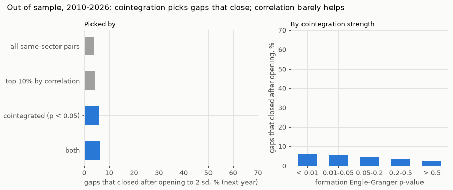
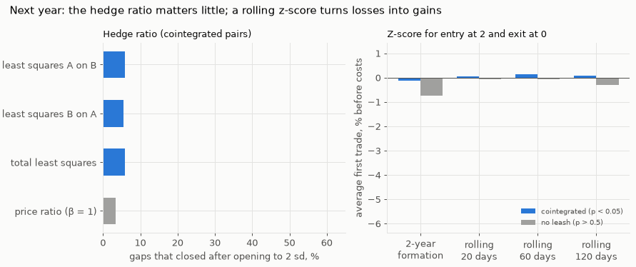

# Pairs Trading

[](https://github.com/Dhirajdas18/pairs-trading/actions/workflows/ci.yml)
[](https://dhirajdas18.github.io/pairs-trading/)

Pairs trading on NSE F&O stocks (about 217, daily data from 2007): which pairs hold together, how to
measure their gap, and what is left after futures costs. Every leg is an F&O stock, because in India a
short held overnight needs a stock future. Every result is scored out of sample.

**Live pair explorer: [dhirajdas18.github.io/pairs-trading](https://dhirajdas18.github.io/pairs-trading/)**,
pick two stocks and see the hedge ratio, cointegration test, half-life, spread, z-score and a backtest,
computed in your browser; rebuilt every week from fresh data by GitHub Actions.

## Features

- [x] Correlation against cointegration: which one picks pairs whose gap closes the next year
- [x] Spread, hedge ratio, z-score and half-life: fixed against rolling z-scores, half-life carry-over
- [ ] Finding pairs across the F&O list, and how many pass by luck
- [ ] A z-score rule out of sample after stock-futures costs and lot sizes
- [ ] When pairs break: stability checks and stop rules
- [ ] Kalman hedge ratio against a fixed one, out of sample
- [ ] A portfolio of pairs against NIFTY after costs

## Findings

### 1. Correlation doesn't find cointegrated pairs; cointegration finds gaps that close

<a href="docs/img/corr_vs_coint.png"><picture><source media="(prefers-reduced-motion: reduce)" srcset="docs/img/corr_vs_coint.png"></picture></a>

<table><tr>
<td><a href="docs/img/corr_vs_pvalue.png"><picture><source media="(prefers-reduced-motion: reduce)" srcset="docs/img/corr_vs_pvalue.png"></picture></a></td>
<td><a href="docs/img/coint_next_year.png"><picture><source media="(prefers-reduced-motion: reduce)" srcset="docs/img/coint_next_year.png"></picture></a></td>
</tr></table>

Correlation asks whether two stocks move the same way on the same day; cointegration asks whether the
gap between their log prices keeps returning to a fixed level, which is what a pair trade bets on. The
Engle-Granger test fits the hedge ratio by least squares and runs an ADF test on the leftover spread
(matches `statsmodels` `coint` to 1e-6). Every same-industry pair of today's F&O stocks is fitted on two
calendar years and followed through the next with everything frozen: 22,139 pair-years, 2010–2026.

- **The two measures are unrelated.** Across 2,378 pairs fitted on 2024–25, the rank correlation between
  return correlation and the cointegration p-value was 0.01. The made-up pairs above show why: 0.84
  correlation with a gap that wanders off (p 0.53), 0.38 with a gap pulled back every week (p < 0.001).
- **Cointegration picks gaps that close.** Once next year's spread moved 2 formation standard deviations,
  it came back to its mean within the year for 48% of cointegrated pairs (p < 0.05), 35% of the 10% most
  correlated and 30% of all pairs. The rate falls steadily with the p-value (51% below 0.01, 21% above
  0.5) and held in 2010–15, 2016–20 and 2021–26.
- **Half still don't close.** Cointegrated pairs looked tight on their fitting years (median spread
  standard deviation 0.079 against 0.125), so next year 95% moved 2 of those deviations and 62% ended the
  year more than 2 away.
- **Many passes are luck:** 10.7% of pair-years had p < 0.05, against 5% if no pair were cointegrated.

### 2. The fitted band is too narrow; a rolling z-score works better, and half-life doubles

<a href="docs/img/spread_example.png"><picture><source media="(prefers-reduced-motion: reduce)" srcset="docs/img/spread_example.png"></picture></a>

<table><tr>
<td><a href="docs/img/spread_choices.png"><picture><source media="(prefers-reduced-motion: reduce)" srcset="docs/img/spread_choices.png"></picture></a></td>
<td><a href="docs/img/half_life.png"><picture><source media="(prefers-reduced-motion: reduce)" srcset="docs/img/half_life.png"></picture></a></td>
</tr></table>

The z-score is how many standard deviations the spread is from its mean. Same pairs and years as
finding 1; each choice is frozen at the end of the fitting years. The trade test enters when |z| > 2,
betting on the gap closing, and exits when z crosses 0 or at year end: first trade per pair-year,
before costs.

- **The fitted band is too narrow.** Next year, cointegrated spreads sat a typical 2.3 formation standard
  deviations from their formation mean, so a fixed z-score was beyond ±2 on 45% of days, where a stable
  spread gives about 5%. HDFC Bank against ICICI Bank (top) passed on 2024–25 (p 0.001, half-life 13
  days), then slid about 30% in 2026; with no stop, its first trade lost about 17% (fixed z) and 13%
  (rolling 60-day z).
- **A rolling z-score turns losses into small gains.** On cointegrated pairs the fixed band averaged
  −0.95% a first trade; rolling 20, 60 and 120-day z-scores averaged +0.57%, +1.09% and +0.66%, winning
  69–71%. On pairs with no cointegration (p > 0.5) every choice lost. The 60-day result was positive in
  14 of 17 years but lost 7% in 2018 and 2020.
- **A rolling z-score always looks like it works:** its mean follows the spread, so it returned to zero
  after nearly every entry, cointegrated or not. Judge it by what the spread did.
- **The hedge-ratio method barely matters.** Least squares of A on B and total least squares both closed
  48% of opened gaps; B on A 45%; a plain price ratio (equal rupees each side) 28%.
- **Half-life doubles.** Cointegrated pairs: median 13 days on the fitting years, 29 the next year; the
  rank correlation between the two was 0.14.

## Quick start

```bash
uv sync
uv run python scripts/fetch_data.py         # Yahoo Finance -> data/prices.parquet
uv run pt report cointegration              # also: spread
uv run python scripts/build_site.py         # pair explorer -> site/index.html
uv run pytest
```

`scripts/fetch_constituents.py` refreshes the stock list (`docs/data/fno.csv`) from NSE's F&O lot
sizes and NIFTY 500 industries.

## Design

- `src/pt/data.py`: Yahoo adjusted closes in one (field, symbol) table; known Yahoo errors (unadjusted
  corporate actions, bad prints) repaired from `docs/data/yahoo_fixes.csv`, each with its source;
  flags suspicious adjusted-price drops.
- `src/pt/pairs.py`: hedge ratio, spread, z-score, half-life, ADF and Engle-Granger with MacKinnon
  p-values (tested against `statsmodels`), z-score backtest with next-day positions.
- `src/pt/pairs.js`: a line-for-line browser copy of `pairs.py`, tested against Python through Node.
- `src/pt/coint.py`: formation/test windows and the correlation-against-cointegration study.
- `src/pt/spread.py`: hedge-ratio methods, rolling z-scores, first-trade test, half-life carry-over.
- `src/pt/site.py`: the pair explorer, one static Plotly page; no server, no committed price data.
- `src/pt/reports.py`: README findings, reproducible with `pt report <topic>` (every number quoted
  above is printed by its report).
- Conventions: log prices; pair order is alphabetical (A regressed on B); formation is two calendar
  years, test the next calendar year. The numbers above use data to 25 Nov 2026; the explorer refreshes
  weekly.
- Survivorship: the universe is today's F&O list, so pairs where a stock failed or left the list are
  missing, which flatters every result.
- Charts: one validated palette; README charts are animated GIFs with a static fallback for
  reduced-motion users.

Research only, not investment advice. MIT licence.
