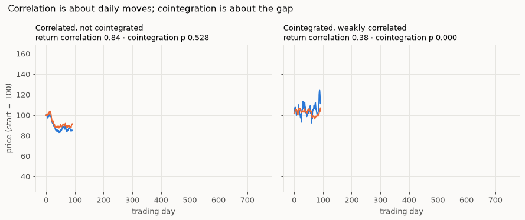
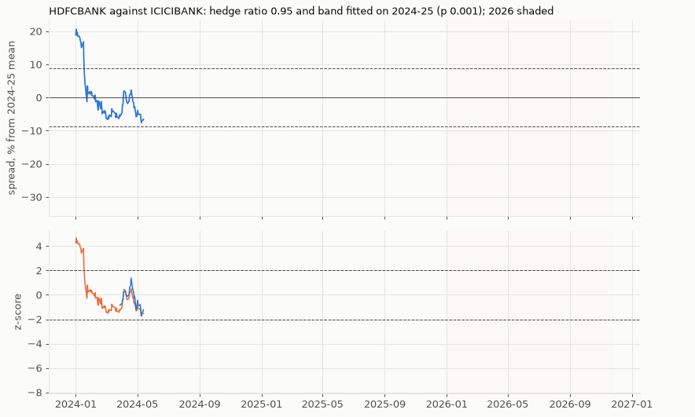

# Pairs trading

[](https://github.com/Dhirajdas18/pairs-trading/actions/workflows/ci.yml)
[](https://dhirajdas18.github.io/pairs-trading/)

Pairs trading on NSE stocks: which pairs move together closely enough to trade one against the other,
how quickly their gaps close, and what is left after costs. Every leg is an F&O stock, because in India
a short position held overnight needs a stock future. The universe is today's NSE F&O list (stocks
in the NIFTY 500, about 217), with daily adjusted closes from Yahoo Finance since 2007.

**Live pair explorer: [dhirajdas18.github.io/pairs-trading](https://dhirajdas18.github.io/pairs-trading/)**.
Pick two stocks and a window: the page fits the hedge ratio in your browser and shows the Engle-Granger
cointegration test, the spread's half-life, the correlation of daily returns, the spread and its
z-score, and a z-score rule backtest before and after costs. Rebuilt weekly from fresh prices.

## Features

- [x] Correlation against cointegration: Engle-Granger test matched to statsmodels; which one picks pairs whose gap closes the next year, out of sample 2010-2026; live pair explorer tested against Python through Node
- [x] Spread, hedge ratio, z-score and half-life: four hedge ratios, fixed against rolling z-scores, half-life carry-over, all out of sample
- [ ] Finding pairs across the F&O list, and how many pass by luck
- [ ] A z-score rule out of sample after stock-futures costs and lot sizes
- [ ] When pairs break: stability checks and stop rules
- [ ] Kalman hedge ratio against a fixed one, out of sample
- [ ] A portfolio of pairs against NIFTY after costs

## Run it

```sh
uv sync
uv run python scripts/fetch_constituents.py   # refresh docs/data/fno.csv from NSE (optional)
uv run python scripts/fetch_data.py           # download prices to data/prices.parquet
uv run pt report <topic>                      # charts to out/ and the topic's numbers
uv run python scripts/build_site.py           # build site/index.html
uv run pytest -q
```

The pair maths lives in `src/pt/pairs.py` (numpy only) with a line-for-line browser copy in
`src/pt/pairs.js`; the tests check the Engle-Granger statistic and p-value against statsmodels and the
browser copy against Python through Node.

Known Yahoo errors (unadjusted corporate actions, bad prints) are repaired from
`docs/data/yahoo_fixes.csv`, each with its source.

## Findings

### 1. Correlation said almost nothing about cointegration; next year, gaps of cointegrated pairs closed 48% of the time once they opened, against 35% for the most correlated pairs and 30% for all pairs

<a href="docs/img/corr_vs_coint.png"><picture><source media="(prefers-reduced-motion: reduce)" srcset="docs/img/corr_vs_coint.png"></picture></a>

Two different questions. **Correlation** of daily returns asks whether the two stocks move the same way
on the same day. **Cointegration** asks whether the gap between their (log) prices keeps returning to a
fixed level. A pair trader bets on the gap, so cointegration is the property that matters. The made-up
pairs above show the two can disagree completely: correlation 0.84 with a gap that wanders off for good
(Engle-Granger p 0.53), and correlation 0.38 with a gap pulled back every week (p < 0.001).

The Engle-Granger test fits log A = α + β · log B by least squares (β is the hedge ratio) and runs an
augmented Dickey-Fuller test on the residual, the spread, with MacKinnon's two-variable p-values. The
code matches `statsmodels.tsa.stattools.coint` to 1e-6.

<table><tr>
<td><a href="docs/img/corr_vs_pvalue.png"><picture><source media="(prefers-reduced-motion: reduce)" srcset="docs/img/corr_vs_pvalue.png"></picture></a></td>
<td><a href="docs/img/coint_next_year.png"><picture><source media="(prefers-reduced-motion: reduce)" srcset="docs/img/coint_next_year.png"></picture></a></td>
</tr></table>

Every pair of today's F&O stocks in the same NSE industry was measured on two calendar years
(formation) and then followed through the next year with the formation hedge ratio, mean and standard
deviation held fixed (test). Test years 2010 to 2026 (2026 to 25 November), 22,139 pair-years. A stock
enters a window only with prices on at least 98% of its days.

- **The two measures are unrelated (left):** across the 2,378 pairs formed on 2024-2025, the rank
  correlation between return correlation and the Engle-Granger p-value was 0.01. High correlation does
  not find cointegrated pairs.
- **Cointegration picks gaps that close (right):** once a test-year spread first moved 2 formation
  standard deviations from its formation mean, it crossed back to that mean before the year ended for
  30% of all pairs, 35% of the top 10% by correlation, 48% of pairs with p < 0.05 and 51% of pairs that
  were both. The rate falls steadily with the p-value: 51% for p < 0.01, 21% for p > 0.5. It held in
  each era: 42% vs 28% (2010-15), 59% vs 38% (2016-20), 45% vs 27% (2021-26).
- **But half still don't close:** cointegrated pairs had tighter formation spreads (median standard
  deviation 0.079 in log price against 0.125), so next year 95% of them moved 2 of those standard
  deviations (87% for all pairs) and 62% ended the year more than 2 away (56%). A spread measured on
  the years it was fitted to looks tighter than it will be.
- **More pass than luck gives, but not by much:** 10.7% of pair-years had p < 0.05, against 5% if no
  pair were cointegrated. Many of the passes are luck, which matters when picking pairs from thousands.

Survivorship: these are today's F&O stocks; pairs where one stock failed or left the list are missing,
which flatters every group.

### 2. Next year a spread typically sat 2.3 of its formation standard deviations from its formation mean, so a fixed band misfires; a 60-day rolling z-score made +1.1% a first trade on cointegrated pairs before costs, against −0.9% for the fixed band, and the half-life doubled

<a href="docs/img/spread_example.png"><picture><source media="(prefers-reduced-motion: reduce)" srcset="docs/img/spread_example.png"></picture></a>

The **spread** is log A − α − β · log B with the hedge ratio β fitted on the formation years; the
**z-score** is how many standard deviations the spread is from its mean. HDFC Bank against ICICI Bank
passed the cointegration test on 2024-25 (p 0.001, β 0.95, half-life 13 days). In 2026 the spread fell
about 30% below its 2024-25 mean: the z-score measured against the formation band sat beyond ±2 on 76%
of days, the 60-day rolling z-score on 14%. Neither stopped a loss: the first trade lost about 17% with the
fixed band and about 13% with the rolling one, held to the end of the year without a stop.

<table><tr>
<td><a href="docs/img/spread_choices.png"><picture><source media="(prefers-reduced-motion: reduce)" srcset="docs/img/spread_choices.png"></picture></a></td>
<td><a href="docs/img/half_life.png"><picture><source media="(prefers-reduced-motion: reduce)" srcset="docs/img/half_life.png"></picture></a></td>
</tr></table>

Same set-up as finding 1 (22,139 same-sector pair-years, 2010-2026; 2,375 cointegrated at p < 0.05),
with each choice frozen at the end of the formation years.

- **The band is too narrow:** the typical (root-mean-square) distance of next year's spread from the
  formation mean was 2.3 formation standard deviations for cointegrated pairs (2.0 for all pairs). A
  z-score built on the formation band was beyond ±2 on 45% of next-year days, where a stable spread would
  give about 5%.
- **Hedge ratio (left):** least squares of A on B and total least squares both closed 48% of opened
  gaps on cointegrated pairs; B on A 45%; a plain price ratio (equal rupees each side) 28%. The fitted
  ratio matters; the method of fitting it barely does.
- **Z-score (right):** enter when |z| > 2, betting on the gap closing, exit when z crosses 0 or at year
  end; first trade per pair-year, before costs. On cointegrated pairs the fixed formation band averaged
  −0.95% (won 58%); a rolling 20, 60 and 120-day z averaged +0.57%, +1.09% and +0.66% (won 69-71%). On
  pairs with no cointegration (p > 0.5) every choice lost (−6.0% fixed, −0.5% rolling 60). The rolling
  60-day result was positive in 14 of 17 years but lost in 2018 (−7.1%) and 2020 (−7.6%), and across
  2016-2020 it averaged −1.9%.
- **A rolling z-score always looks like it works:** its mean follows the spread, so it crossed back to
  zero after nearly every entry, cointegrated or not (99.7% of opened gaps at 60 days). Judge it by what
  the spread did, not by whether z came back.
- **Half-life does not carry over:** for cointegrated pairs the median half-life was 13 days on the
  formation years and 29 days the next year; the rank correlation between the two was 0.14, and 4% of
  pairs did not revert at all.

Research only, not investment advice. Results computed on today's F&O list are survivorship-biased:
stocks that were dropped from the list or delisted are not in the data.
